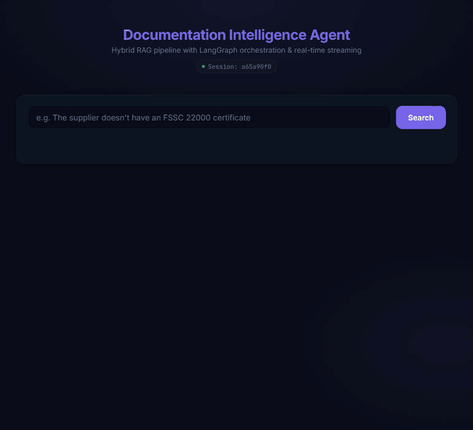
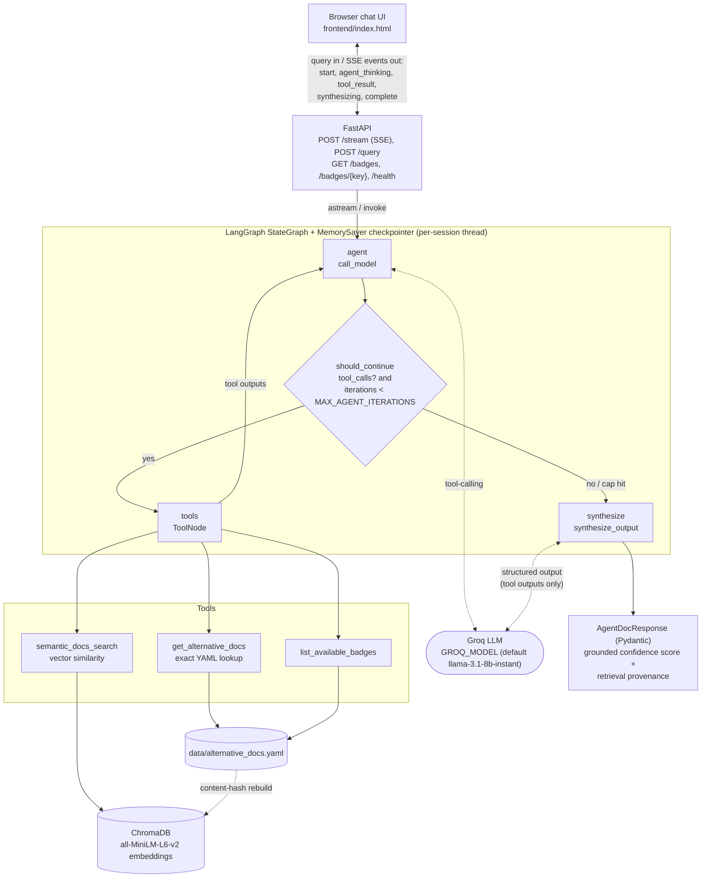

# AI YAML Specification Assistant

[](https://github.com/Jatheel/ai-yaml-spec-assistant/actions/workflows/python-app.yml)

Production-grade documentation intelligence agent that interprets user queries, evaluates YAML specifications, and returns structured API documentation with grounded confidence scoring. The included dataset is a generic, synthetic example for demonstrating YAML-driven tool use.



*Real run against the local API: the query streams through Init → Agent → Tools → Synthesize, then returns an 85%-confidence answer grounded in an exact YAML badge match.*

## Key Features

- **Stateful LangGraph Agent** — Cyclic tool execution with iteration guards, context isolation, and schema-constrained output synthesis
- **Hybrid Retrieval (RAG)** — Combines deterministic YAML key lookup with dense semantic vector search via ChromaDB and HuggingFace sentence transformers
- **Asynchronous SSE Streaming** — Real-time agent state transitions and tool-execution updates via Server-Sent Events
- **Hallucination Mitigation** — Context-isolated synthesis node uses only grounded tool outputs; confidence scores are computed from retrieval signals, not LLM-generated
- **Conversation Memory** — Session-persistent conversation context via LangGraph MemorySaver checkpointer
- **Structured Output Validation** — Pydantic schemas enforce response structure with provenance tracking and contextual follow-up recommendations

## Architecture / Pipeline



**How a query flows:** the `agent` node asks the LLM which tools to call; `ToolNode` runs them and loops back until the model stops requesting tools or the iteration cap (`MAX_AGENT_ITERATIONS`, default 5) is hit. `synthesize` then formats the answer from tool outputs only — no conversation history — and overrides the confidence score with one computed from retrieval signals (exact match vs. semantic match vs. both), so the score is never LLM-generated.

### Tools

| Tool | Type | Purpose |
|------|------|---------|
| `get_alternative_docs` | Deterministic | Exact YAML badge lookup with multi-strategy matching |
| `semantic_docs_search` | Semantic | Dense vector similarity search via ChromaDB |
| `list_available_badges` | Deterministic | Enumerate all badges in the specification database |

## Project Structure

- `config.py` — Centralized Pydantic Settings configuration
- `api/` — FastAPI application with SSE streaming and REST endpoints
- `agent/` — LangGraph orchestration, state management, and synthesis
- `tools/` — YAML-backed lookup, semantic search, and badge listing tools
- `data/` — Generic synthetic specification rules and ChromaDB vector store
- `frontend/` — Premium static HTML chat client with pipeline visualization

## Prerequisites

- Python 3.10+
- A Groq API key

## Setup

Create and activate a virtual environment, then install dependencies:

```powershell
python -m venv venv
venv\Scripts\Activate.ps1
pip install -r requirements.txt
```

Create a `.env` file in the project root:

```env
GROQ_API_KEY=your_groq_api_key_here
GROQ_MODEL=llama-3.1-8b-instant
API_PORT=8000
LOG_LEVEL=INFO
```

## Run The App

Open two terminals from the project root.

Start the backend API:

```powershell
python -m uvicorn api.main:app --host 127.0.0.1 --port 8000
```

Start the frontend server:

```powershell
python -m http.server 5500 --bind 127.0.0.1 --directory frontend
```

Open `http://127.0.0.1:5500` for the chat UI or `http://127.0.0.1:8000/docs` for the API documentation.

## API Endpoints

| Method | Endpoint | Description |
|--------|----------|-------------|
| `GET` | `/health` | Health check with dependency status |
| `GET` | `/badges` | List all available certification badges |
| `GET` | `/badges/{key}` | Get alternative documents for a specific badge |
| `POST` | `/query` | Synchronous agent query with structured response |
| `POST` | `/stream` | SSE streaming with real-time pipeline events |

## Quick Test Prompt

Try: `The supplier doesn't have an FSSC 22000 certificate`

The assistant returns alternative document combinations in confidence order, including required fields, conditions, and common recovery actions — with grounded confidence scoring and retrieval provenance.

## Configuration Notes

- Edit `data/alternative_docs.yaml` to add or revise synthetic specifications. The vector store auto-rebuilds when the YAML content hash changes.
- Set `GROQ_MODEL` in `.env` to another model available to your Groq account (e.g., `llama-3.1-8b-instant` for faster inference).
- The frontend expects the API at `http://127.0.0.1:8000`; update the `API` constant in `frontend/index.html` for another local port.
- Never commit `.env` or real supplier documents. Use `.env.example` as the credential template.

## Tech Stack

Python · FastAPI · LangGraph · LangChain · Groq · ChromaDB · HuggingFace Transformers · Pydantic
